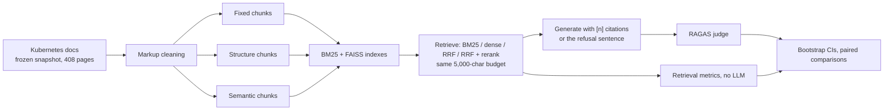

# rag-k8s-eval

**Does a RAG system tell the truth, and which design choices actually matter?**
A retrieval-augmented question-answering system over the official Kubernetes
documentation, built around its *evaluation*: every design choice (chunking,
retrieval, generator) is compared with measured numbers and 95% confidence
intervals, not by eye.

[](https://github.com/HamzaOuba00-1/rag-k8s-eval/actions/workflows/ci.yml)

## What is measured

- **Retrieval** — 3 chunking strategies (fixed-size, Markdown structure, semantic) ×
  4 retrievers (BM25, dense, hybrid RRF, hybrid + cross-encoder reranking), scored
  without any LLM: is the question's source page in the context, and at which rank?
- **Generation** — answers must cite the excerpts they use (`[n]`) and refuse
  explicitly when the information is not there. Measured: RAGAS faithfulness,
  answer relevancy, context precision and recall; refusal rate on out-of-corpus
  questions; false refusals; share of sentences carrying a citation.
- **The judge itself** — RAGAS scores come from an LLM judge, so its agreement with
  an independent annotator is checked on a blind sample (here another LLM: not a
  human validation, see below).
- **Uncertainty** — about 50 questions is small: every mean has a bootstrap
  interval and every comparison is a *paired* bootstrap difference on the same
  questions.

## Results

### Retrieval (top configurations)

<!-- BEGIN:retrieval-top -->
Retrieval only, no LLM. 45 factual questions; relevant = the question's source page is in the
context given to the generator (5,000 characters for every strategy). Mean with 95% bootstrap CI. Computed 2026-11-22.

| Chunking | Retrieval | MRR | Hit@1 | Hit@ctx | ΔMRR vs best (paired) |
|---|---|---|---|---|---|
| fixed | hybrid_rerank | 0.84 [0.75, 0.92] | 0.76 | 0.96 | reference |
| structure | hybrid_rerank | 0.83 [0.73, 0.91] | 0.73 | 0.98 | -0.015 [-0.094, +0.059] |
| semantic | hybrid | 0.80 [0.70, 0.89] | 0.73 | 0.98 | -0.040 [-0.137, +0.045] |
| structure | hybrid | 0.79 [0.69, 0.87] | 0.67 | 0.96 | -0.056 [-0.160, +0.050] |
| fixed | hybrid | 0.77 [0.67, 0.87] | 0.67 | 0.96 | -0.067 [-0.172, +0.036] |

Top 5 of 12 configurations; full tables in [`results/retrieval_metrics.md`](results/retrieval_metrics.md).
<!-- END:retrieval-top -->

### Generation and RAGAS

<!-- BEGIN:generation -->
Generator `qwen3.8-27b`; judge `gemma4:12b-it-q8_0`. Mean with 95% bootstrap CI over questions.

| Chunking | Retrieval | Faithfulness | Answer relevancy | Context precision | Context recall | Refused out-of-corpus | False refusals |
|---|---|---|---|---|---|---|---|
| fixed | hybrid_rerank | 0.98 [0.95, 1.00] | 0.88 [0.83, 0.91] | 0.89 [0.82, 0.95] | 0.96 [0.89, 1.00] | 1.00 [1.00, 1.00] | 0.02 [0.00, 0.07] |
| structure | hybrid_rerank | 0.99 [0.98, 1.00] | 0.87 [0.83, 0.91] | 0.92 [0.87, 0.96] | 0.97 [0.91, 1.00] | 1.00 [1.00, 1.00] | 0.00 [0.00, 0.00] |
| semantic | hybrid_rerank | 0.98 [0.96, 1.00] | 0.90 [0.86, 0.93] | 0.72 [0.63, 0.81] | 0.90 [0.81, 0.98] | 1.00 [1.00, 1.00] | 0.04 [0.00, 0.11] |
| fixed | bm25 | 0.99 [0.98, 1.00] | 0.89 [0.85, 0.92] | 0.80 [0.70, 0.88] | 0.94 [0.88, 1.00] | 1.00 [1.00, 1.00] | 0.04 [0.00, 0.11] |
| fixed | dense | 0.99 [0.96, 1.00] | 0.88 [0.84, 0.92] | 0.65 [0.56, 0.74] | 0.93 [0.84, 1.00] | 1.00 [1.00, 1.00] | 0.07 [0.00, 0.16] |
| fixed | hybrid | 0.98 [0.95, 1.00] | 0.87 [0.83, 0.91] | 0.84 [0.76, 0.91] | 0.96 [0.89, 1.00] | 1.00 [1.00, 1.00] | 0.04 [0.00, 0.11] |

Full tables and paired differences: [`results/comparison.md`](results/comparison.md).
<!-- END:generation -->

### Application generator vs reference generator

<!-- BEGIN:models -->
Same contexts (`fixed_hybrid_rerank`), same prompt, same judge. Δ = paired bootstrap difference (* = CI excludes 0).

| Metric | qwen3.8-27b | qwen2.5-7b-instruct | Δ |
|---|---|---|---|
| faithfulness | 0.98 [0.95, 1.00] | 0.94 [0.89, 0.99] | +0.039 [-0.008, +0.093] |
| answer relevancy | 0.88 [0.83, 0.91] | 0.86 [0.80, 0.91] | -0.012 [-0.063, +0.036] |
| citation coverage | 0.91 [0.84, 0.97] | 0.68 [0.56, 0.78] | +0.229 [+0.129, +0.338] * |
| seconds per answer (mean) | 0.47 | 4.61 | — |
<!-- END:models -->

### How far can the judge be trusted?

<!-- BEGIN:agreement -->
40 answers labelled by an LLM (claude-opus-5-5, 0 / 0.5 / 1) without seeing the judge's scores: this is agreement between two models, not a human validation. Bias > 0 = judge more lenient than the annotator. n/a = one side gives the same value to every answer.

| Metric | Spearman [95% CI] | MAE | Bias (judge - annotator) | Cohen's κ (≥ 0.5) | Mean, annotator / judge |
|---|---|---|---|---|---|
| faithfulness | -0.04 [-0.09, -0.03] | 0.04 | -0.01 [-0.05, +0.03] | n/a | 0.99 / 0.97 |
| answer_relevancy | 0.27 [0.15, 0.46] | 0.13 | -0.11 [-0.15, -0.07] | n/a | 0.97 / 0.87 |
| context_recall | 0.72 [0.52, 1.00] | 0.01 | +0.01 [+0.00, +0.04] | 1.00 | 0.96 / 0.97 |
<!-- END:agreement -->

Methodology, run conditions and limitations: [REPORT.md](REPORT.md).

## Pipeline



| Stage | Choice |
|---|---|
| Corpus | Kubernetes docs (concepts, tasks, tutorials) at upstream commit `5184b9b`, 408 pages, reproducible byte for byte |
| Chunking | fixed 1,000 chars (150 overlap) · Markdown `##`/`###` sections (≤ 1,500 chars) · semantic (sentence-embedding similarity ≥ 0.55) |
| Retrieval | `rank_bm25` · `all-MiniLM-L6-v2` + FAISS · Reciprocal Rank Fusion (k = 60) · `ms-marco-MiniLM-L-6-v2` cross-encoder |
| Context | ranked chunks up to 5,000 characters for every strategy (fair across chunk sizes) |
| Generators | `qwen/qwen3.8-27b` on Groq (reasoning off) · `qwen2.5:7b-instruct` with Ollama as reference |
| Judge | `gemma4:12b-it-q8_0` with Ollama (another model family), RAGAS 0.4.3 |
| Gold set | 45 factual questions (18 drafted from whole pages, 27 from chunks) + 8 out-of-corpus questions |

## Reproduce

```bash
python -m venv .venv && source .venv/bin/activate   # Windows: .venv\Scripts\Activate.ps1
pip install -e ".[dev]"
python -m ragk8s ingest --verify       # check the frozen corpus
python -m ragk8s chunk && python -m ragk8s index
python -m ragk8s retrieve --all && python -m ragk8s retrieval-metrics
python -m ragk8s generate --provider groq --preset main   # needs GROQ_API_KEY; resumable, quota-aware
python -m ragk8s compare
```

Every step, including the Kaggle notebooks for the reference generator and the
judge, is documented in [docs/REPRODUCE.md](docs/REPRODUCE.md). Runs are cached and
resumable; each run records model digest, decoding options, code commit and timing.

## Repository layout

```
src/ragk8s/        package: ingestion, chunking, indexing, retrieval, generation,
                   pipeline, judge, statistics, comparison, CLI
tests/             unit tests (no model, no network)
eval/              gold questions, review sheets, dropped questions with reasons
results/           metrics, comparison tables, figures, summary.json
kaggle/            notebooks for the GPU work (reference generator, judge)
data/raw/          frozen corpus snapshot (CC BY 4.0, see NOTICE)
```

## Limitations (short version)

The gold set is small (45 factual questions) and its review was LLM-assisted, then
validated by the author; the application generator is a preview model on a free
API tier; RAGAS scores come from a single 12B judge with no human validation (its
agreement with another LLM is reported above, under a strong ceiling effect). Details in [REPORT.md](REPORT.md#limitations).

## License and attribution

- Documentation corpus: © The Kubernetes Authors, [CC BY 4.0](https://creativecommons.org/licenses/by/4.0/),
  modified (front matter removed, files renamed); see [NOTICE](NOTICE).
- Unofficial project, not affiliated with the Linux Foundation or the Kubernetes project.
- Code: [MIT License](LICENSE), © 2026 Hamza Ouba.
