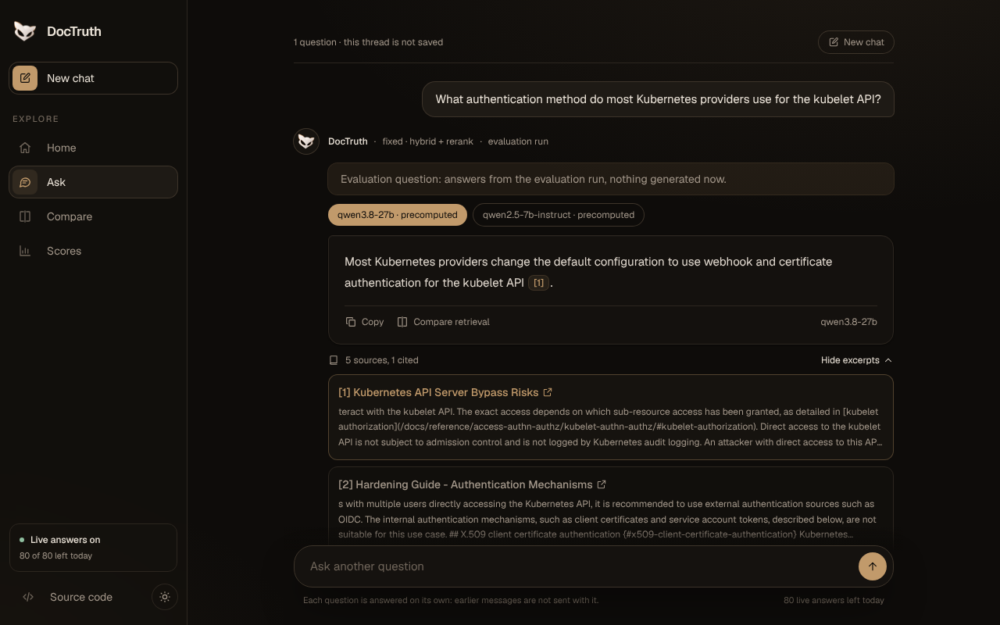
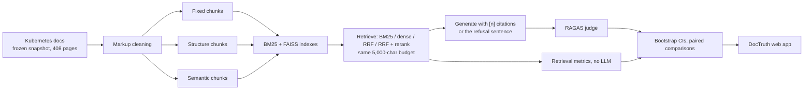
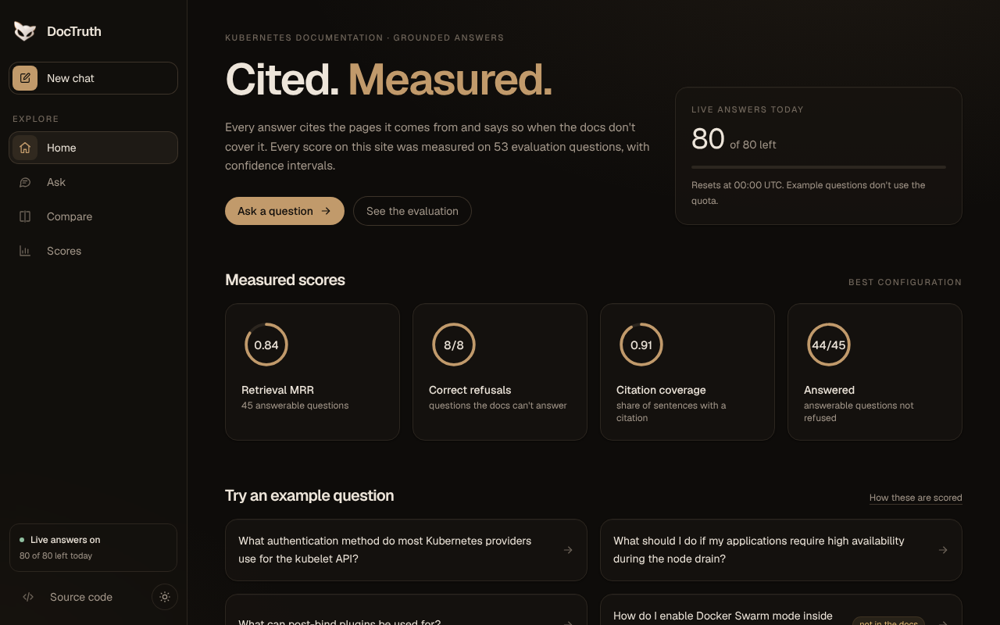
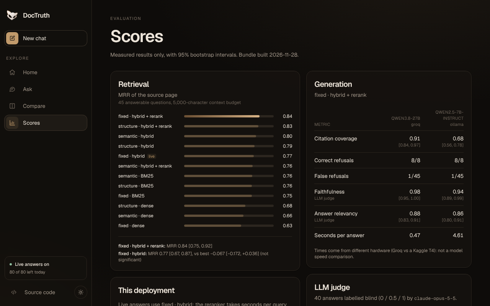

<div align="center">


# DocTruth · rag-k8s-eval

**Cited, measured answers over the Kubernetes documentation.**
A retrieval-augmented QA system built around its *evaluation*: every design choice is
compared with measured numbers and 95% confidence intervals, not by eye.

[](https://github.com/HamzaOuba00-1/rag-k8s-eval/actions/workflows/ci.yml)
[](https://doctruth-117454464399.us-central1.run.app)

[](LICENSE)
[](NOTICE)

**[Live demo](https://doctruth-117454464399.us-central1.run.app)** ·
[Evaluation report](REPORT.md) · [Reproduce](docs/REPRODUCE.md) · [Deploy](docs/DEPLOY.md)



</div>

## Highlights

All numbers below come from the result files of this repository (45 factual and 8
out-of-corpus questions; 95% bootstrap intervals; comparisons are paired on the same questions).

- **Retrieval, measured without any LLM**: 3 chunking strategies × 4 retrievers. Best:
  fixed chunks + hybrid search + cross-encoder reranking, **MRR 0.84 [0.75, 0.92]**.
  Dense retrieval alone is significantly worse (ΔMRR −0.21 [−0.34, −0.07]) on these
  identifier-heavy docs. *(results/retrieval_metrics.md, 2026-11-22)*
- **It says when it doesn't know**: **8/8 out-of-corpus questions refused** and
  **0 answers with an invalid citation**, in every evaluated configuration.
  *(results/comparison.md, 2026-11-28)*
- **Generator choice, isolated**: at equal context, the 27B application model cites far
  more than a 7B reference (**+0.23 citation coverage [+0.13, +0.34]**), with no
  significant difference in faithfulness. *(results/comparison.md)*
- **Shipped for free tiers**: ONNX embedder with **100% identical contexts** to PyTorch
  (int8 rejected: it changed the retrieved context), Cloud Run scaled to zero,
  **6.1 s measured cold start**, daily and per-visitor quotas, strict CSP.
  *(results/onnx_parity.json, docs/DEPLOY.md)*
- **Honest limits**: RAGAS scores come from one LLM judge, checked against another
  LLM, **not validated by humans**; the gold set is small. See [Limitations](#limitations).

## What this project demonstrates

| Area | What was done | Where |
|---|---|---|
| Retrieval engineering | 3 chunkers, BM25, MiniLM + FAISS, Reciprocal Rank Fusion, cross-encoder reranking, equal 5,000-character context budget | `src/ragk8s/chunking.py`, `retrieval.py` |
| Evaluation design | Gold set with a neutral subset, page-level relevance, selection rule fixed before any LLM evaluation, refusal and citation checks without a judge | `eval/`, `retrieval_metrics.py`, `citations.py`, `refusal.py` |
| Statistics | Percentile bootstrap and paired bootstrap differences, judge agreement (Spearman, MAE, bias, Cohen's κ) | `stats.py`, `validation.py` |
| LLM engineering | Citation-or-refusal prompt, deterministic decoding, answer cache keyed by every input, quota-aware Groq client, RAGAS judge on Kaggle | `generation.py`, `pipeline.py`, `groq_client.py`, `judge.py` |
| Reproducibility | Corpus frozen at an upstream commit (SHA-256 per page), runs record model digest, options, commit and timing; README/REPORT tables generated, never typed | `ingestion.py`, `report.py` |
| Deployment | FastAPI + React app, ONNX models without PyTorch, Docker, Cloud Run, Secret Manager, quotas, security headers, CI | `app/`, `web/`, `Dockerfile`, `docs/DEPLOY.md` |

## Results

### Retrieval (top configurations)

<!-- BEGIN:retrieval-top -->
Retrieval only, no LLM. 45 factual questions; relevant = the question's source page is in the
context given to the generator (5,000 characters for every strategy). Mean with 95% bootstrap CI. Computed 2026-11-22.

| Chunking | Retrieval | MRR | Hit@1 | Hit@ctx | ΔMRR vs best (paired) |
|---|---|---|---|---|---|
| fixed | hybrid_rerank | 0.84 [0.75, 0.92] | 0.76 | 0.96 | reference |
| structure | hybrid_rerank | 0.83 [0.73, 0.91] | 0.73 | 0.98 | -0.015 [-0.094, +0.059] |
| semantic | hybrid | 0.80 [0.70, 0.89] | 0.73 | 0.98 | -0.040 [-0.137, +0.045] |
| structure | hybrid | 0.79 [0.69, 0.87] | 0.67 | 0.96 | -0.056 [-0.160, +0.050] |
| fixed | hybrid | 0.77 [0.67, 0.87] | 0.67 | 0.96 | -0.067 [-0.172, +0.036] |

Top 5 of 12 configurations; full tables in [`results/retrieval_metrics.md`](results/retrieval_metrics.md).
<!-- END:retrieval-top -->

### Generation and RAGAS

<!-- BEGIN:generation -->
Generator `qwen3.8-27b`; judge `gemma4:12b-it-q8_0`. Mean with 95% bootstrap CI over questions.

| Chunking | Retrieval | Faithfulness | Answer relevancy | Context precision | Context recall | Refused out-of-corpus | False refusals |
|---|---|---|---|---|---|---|---|
| fixed | hybrid_rerank | 0.98 [0.95, 1.00] | 0.88 [0.83, 0.91] | 0.89 [0.82, 0.95] | 0.96 [0.89, 1.00] | 1.00 [1.00, 1.00] | 0.02 [0.00, 0.07] |
| structure | hybrid_rerank | 0.99 [0.98, 1.00] | 0.87 [0.83, 0.91] | 0.92 [0.87, 0.96] | 0.97 [0.91, 1.00] | 1.00 [1.00, 1.00] | 0.00 [0.00, 0.00] |
| semantic | hybrid_rerank | 0.98 [0.96, 1.00] | 0.90 [0.86, 0.93] | 0.72 [0.63, 0.81] | 0.90 [0.81, 0.98] | 1.00 [1.00, 1.00] | 0.04 [0.00, 0.11] |
| fixed | bm25 | 0.99 [0.98, 1.00] | 0.89 [0.85, 0.92] | 0.80 [0.70, 0.88] | 0.94 [0.88, 1.00] | 1.00 [1.00, 1.00] | 0.04 [0.00, 0.11] |
| fixed | dense | 0.99 [0.96, 1.00] | 0.88 [0.84, 0.92] | 0.65 [0.56, 0.74] | 0.93 [0.84, 1.00] | 1.00 [1.00, 1.00] | 0.07 [0.00, 0.16] |
| fixed | hybrid | 0.98 [0.95, 1.00] | 0.87 [0.83, 0.91] | 0.84 [0.76, 0.91] | 0.96 [0.89, 1.00] | 1.00 [1.00, 1.00] | 0.04 [0.00, 0.11] |

Full tables and paired differences: [`results/comparison.md`](results/comparison.md).
<!-- END:generation -->

### Application generator vs reference generator

<!-- BEGIN:models -->
Same contexts (`fixed_hybrid_rerank`), same prompt, same judge. Δ = paired bootstrap difference (* = CI excludes 0).

| Metric | qwen3.8-27b | qwen2.5-7b-instruct | Δ |
|---|---|---|---|
| faithfulness | 0.98 [0.95, 1.00] | 0.94 [0.89, 0.99] | +0.039 [-0.008, +0.093] |
| answer relevancy | 0.88 [0.83, 0.91] | 0.86 [0.80, 0.91] | -0.012 [-0.063, +0.036] |
| citation coverage | 0.91 [0.84, 0.97] | 0.68 [0.56, 0.78] | +0.229 [+0.129, +0.338] * |
| seconds per answer (mean) | 0.47 | 4.61 | — |
<!-- END:models -->

### How far can the judge be trusted?

<!-- BEGIN:agreement -->
40 answers labelled by an LLM (claude-opus-5-5, 0 / 0.5 / 1) without seeing the judge's scores: this is agreement between two models, not a human validation. Bias > 0 = judge more lenient than the annotator. n/a = one side gives the same value to every answer.

| Metric | Spearman [95% CI] | MAE | Bias (judge - annotator) | Cohen's κ (≥ 0.5) | Mean, annotator / judge |
|---|---|---|---|---|---|
| faithfulness | -0.04 [-0.09, -0.03] | 0.04 | -0.01 [-0.05, +0.03] | n/a | 0.99 / 0.97 |
| answer_relevancy | 0.27 [0.15, 0.46] | 0.13 | -0.11 [-0.15, -0.07] | n/a | 0.97 / 0.87 |
| context_recall | 0.72 [0.52, 1.00] | 0.01 | +0.01 [+0.00, +0.04] | 1.00 | 0.96 / 0.97 |
<!-- END:agreement -->

Methodology, run conditions and full limitations: [REPORT.md](REPORT.md).

## How it works



| Stage | Choice |
|---|---|
| Corpus | Kubernetes docs (concepts, tasks, tutorials) at upstream commit `5184b9b`, 408 pages, reproducible byte for byte |
| Chunking | fixed 1,000 chars (150 overlap) · Markdown `##`/`###` sections (≤ 1,500 chars) · semantic (sentence-embedding similarity ≥ 0.55) |
| Retrieval | `rank_bm25` · `all-MiniLM-L6-v2` + FAISS · Reciprocal Rank Fusion (k = 60) · `ms-marco-MiniLM-L-6-v2` cross-encoder |
| Context | ranked chunks up to 5,000 characters for every strategy (fair across chunk sizes) |
| Generators | `qwen/qwen3.8-27b` on Groq (reasoning off) · `qwen2.5:7b-instruct` with Ollama as reference |
| Judge | `gemma4:12b-it-q8_0` with Ollama on a Kaggle GPU (another model family), RAGAS 0.4.3 |
| Gold set | 45 factual questions (18 drafted from whole pages, 27 from chunks) + 8 out-of-corpus questions |

## The app

<table>
<tr>
<td width="50%"></td>
<td width="50%"></td>
</tr>
</table>

- **Ask**: a chat thread; evaluation questions show the answers of both evaluated models
  (precomputed, with the best configuration); other questions are answered live.
- **Compare**: what each chunking strategy and retriever finds for the same question.
- **Scores**: the measured results above, with their intervals and the judge check.

Trade-offs, all measured: live answers use fixed + hybrid search without the reranker
(the cross-encoder takes about 10 s per query on one CPU thread, for an MRR gain that is
not significant: −0.067 [−0.172, +0.036]). The app stores no question and keeps no visitor
address (only an in-memory keyed hash for rate limiting); questions are sent to Groq to
generate the answer. Details: [docs/DEPLOY.md](docs/DEPLOY.md).

**Stack**: Python · sentence-transformers · FAISS · rank_bm25 · RAGAS · Ollama · Groq ·
ONNX Runtime · FastAPI · React · TypeScript · Tailwind CSS · Docker · Google Cloud Run ·
GitHub Actions.

## Reproduce

```bash
python -m venv .venv && source .venv/bin/activate   # Windows: .venv\Scripts\Activate.ps1
pip install -e ".[dev]"
python -m ragk8s ingest --verify       # check the frozen corpus
python -m ragk8s chunk && python -m ragk8s index
python -m ragk8s retrieve --all && python -m ragk8s retrieval-metrics
python -m ragk8s generate --provider groq --preset main   # needs GROQ_API_KEY; resumable, quota-aware
python -m ragk8s compare && python -m ragk8s report
```

Every step, including the Kaggle notebooks for the reference generator and the
judge, is documented in [docs/REPRODUCE.md](docs/REPRODUCE.md). Runs are cached and
resumable; each run records model digest, decoding options, code commit and timing.
Running the web app locally and deploying it: [docs/DEPLOY.md](docs/DEPLOY.md).

## Repository layout

```
src/ragk8s/        package: ingestion, chunking, indexing, retrieval, generation,
                   pipeline, judge, statistics, comparison, ONNX, CLI
app/               FastAPI API of the web app (quotas, security headers)
web/               React front end (Vite, TypeScript, Tailwind)
tests/             unit tests (no model, no network)
eval/              gold questions, review sheets, dropped questions with reasons
results/           metrics, comparison tables, judge scores, figures, summary.json
kaggle/            notebooks for the GPU work (reference generator, judge)
data/raw/          frozen corpus snapshot (CC BY 4.0, see NOTICE)
docs/              reproduction and deployment guides
```

## Limitations

The gold set is small (45 factual questions) and its review was LLM-assisted, then
validated by the author; questions drafted from structure chunks favour that strategy,
which is why a neutral page-based subset is reported. The application generator is a
preview model on a free API tier. RAGAS scores come from a single 12B judge with no
human validation (its agreement with another LLM is reported above, under a strong
ceiling effect). Details in [REPORT.md](REPORT.md#7-limitations).

## License and attribution

- Documentation corpus: © The Kubernetes Authors, [CC BY 4.0](https://creativecommons.org/licenses/by/4.0/),
  modified (front matter removed, files renamed); see [NOTICE](NOTICE).
- Unofficial project, not affiliated with the Linux Foundation or the Kubernetes project.
- Code: [MIT License](LICENSE), © 2026 Hamza Ouba.

**Author**: Hamza Ouba · [spaceh.online](https://spaceh.online) · [GitHub](https://github.com/HamzaOuba00-1)
